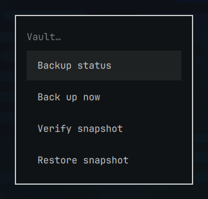

# Shahid's AI Agents Workshop

Set up an Omarchy PC as a home for AI agents to clone repositories and run the jobs you assign, from the desktop or remotely. The workshop also includes desktop integrations for mail, Microsoft 365, OneDrive, and ChatGPT Dot.

## Set up a fresh Omarchy PC

Use an Omarchy Quattro desktop with Lua-based Hyprland. Run setup as your regular desktop user. Package installation and system services may ask for sudo.

### A. Ask an agent

Open Codex, Claude Code, or your preferred agent harness on the Omarchy PC and give it this prompt:

> Set up this Omarchy PC using https://github.com/shah/workshop. Read the README and AGENTS.md, preview the changes, then apply them. Fix recoverable errors and tell me when you need me at the keyboard for sudo or sign-in. Verify the setup by cloning a test repo and starting an available agent in it. Report what passed and what remains.

### B. Run the bootstrap

```bash
curl -fsSL https://raw.githubusercontent.com/shah/workshop/main/bootstrap.sh | sh
```

The bootstrap fetches one Git revision, installs Bun if needed, and runs the installer.

### C. Run the installer from a clone

```bash
git clone https://github.com/shah/workshop.git "$HOME/Work/github.com/shah/workshop"
cd "$HOME/Work/github.com/shah/workshop"
command -v bun >/dev/null || omarchy pkg add bun || omarchy pkg aur add bun-bin
bun --no-env-file ./snshah.ts plan
bun --no-env-file ./snshah.ts apply
```

The default workspace root is `~/Work`. Set `workspacesRoot` in your private config or pass `--workspaces-root "$HOME/Client Work"` to preview or apply with a different root. On first installation, that flag seeds the config. The generated `repository` setting uses `shah/workshop` as the example. Run `snshah workspace` to print the configured checkout path.

## Fresh-install defaults

Setup checks for existing apps and launchers before using Omarchy's installers. Run `snshah plan` to see what is missing.

| Default | Installation path |
| --- | --- |
| Bun | `omarchy pkg add bun`, with `omarchy pkg aur add bun-bin` as fallback, before the CLI runs |
| VS Code | `omarchy install editor vscode` when `code` is missing |
| Microsoft Edge | `omarchy install browser edge`, then `omarchy default browser edge` |
| Oh My Posh | `omarchy pkg aur add oh-my-posh-bin`, with the bundled prompt theme |
| age, gum, Herdr, rclone, FUSE | `omarchy pkg add` when missing |
| Spotify | `omarchy install service spotify` if a client or web launcher is missing |
| WhatsApp and Discord | Existing enabled launchers, or Omarchy web apps if missing or hidden |
| Gmail, Google Voice, Cloudflare Admin, UniFi Admin | Omarchy web apps. UniFi opens `https://unifi.ui.com/`. |

Ollama and local OpenCode are opt-in. Setup creates the personal OneDrive mount directory and mounts an already-configured remote when available. First-time Microsoft sign-in remains interactive.

## Open the Workshop menu

- **Super + Alt + Space → Workshop** opens the submenu from Omarchy’s root menu.
- **Super + Alt + M** or `snshah menu` opens it directly. Check `omarchy menu keybindings --print` if you already use the shortcut.
- `snshah plugin install` adds the optional **Workshop** status widget to the right side of the native bar. `snshah plugin toggle` opens the Workshop menu and `snshah plugin remove` removes the widget. The native root menu entry stays available. The plugin is bundled here and installed locally. Run `snshah plugin install` again to refresh an existing widget.

Use the arrow keys and Enter, or type to filter. Each configured tenant gets a submenu, numbered in config order. **Open → Accounts by name** reads private display names at runtime. The generated Omarchy menu file uses generic titles. Agent sessions, mounts, vault passphrases, and secret entry open in an Omarchy terminal. **Setup & Diagnostics → Apply changes** previews the changes and asks for confirmation.

| Menu | CLI |
| --- | --- |
| Open | `snshah open gmail`, `snshah open voice`, `snshah open menu`, `snshah open hints` |
| Personal OneDrive | `snshah drive connect personal`, `snshah drive mount personal`, `snshah drive folder personal` |
| Tenant submenus | `snshah open studio outlook`, `snshah drive list research`, `snshah drive mount research` |
| Agents | `snshah agent claude\|codex\|local [directory]` |
| Configuration | `snshah config setup\|check\|edit`, `snshah config set-secret VARIABLE`, `snshah shell` |
| Setup & Diagnostics | `snshah plan`, `snshah apply`, `snshah doctor --json`, `snshah workspace`, `snshah context`, `snshah test` |
| Vault | `snshah vault status\|backup\|verify\|restore` |
| Plugin | `snshah plugin install\|toggle\|remove` |

The native menu is generated from the command table embedded in `snshah.ts`. Omarchy’s menu definition has a fixed JSONC path. Edit the TypeScript config for Workshop settings.

## Workshop status bar

Click the widget for OneDrive mount status, the local Ollama state and model, agent shortcuts, and **Back up config**. The **Apps and accounts** picker includes your communication apps, cloud admin tools, ChatGPT Dot, and configured work accounts. Right-click the widget to open the full Workshop menu. In the panel, use arrows and Enter to choose an action, and Escape to close it.

The bar shows a mount count, local AI state, and a backup-due marker. Hover for the full status. The panel resolves display labels only while open. `snshah status` returns the compact state as JSON. `snshah status --details` includes drive labels and mount states. These checks use local mount and remote registration data, so **Ready to mount** means the remote is configured. An expired Microsoft session may still need reconnection. Omarchy’s native Agents and Media widgets remain available for usage and playback.

## Configure profiles, preferences, and secrets


The only Workshop settings file is **`~/.config/snshah.conf.ts`**. Setup creates it with mode **0600**. You must own the file, and it must be a regular file. It contains executable TypeScript, so review it before loading a copy from another machine. The generated `snshah.auto.d.ts` exposes the config types to VS Code.

1. Open **Configuration → Edit in VS Code** and add tenants to the `work` array. A fresh install starts with an empty array. Use **Name my profiles** to rename entries you’ve already added. The screenshots use example tenants.
2. Open **Configuration → Edit in VS Code** or run `snshah config edit`. This opens the private config in a dedicated VS Code window with format-on-save, autocomplete, and inline TypeScript diagnostics. See [Editing in VS Code](#editing-in-vs-code).
3. Run `snshah config check`, followed by `snshah plan` and `snshah apply` when a setting requires package or desktop changes.

Configuration options include:

| Setting | Values |
| --- | --- |
| `personal`, `work[].label` | Editable display names. |
| `work[].id` | Stable, unique tenant ID. Use lowercase letters, digits, and hyphens, starting with a letter. |
| `workspacesRoot` | Absolute path for managed checkouts |
| `repository` | Default GitHub repository in `owner/name` form. Starts as `shah/workshop`. |
| `browser` | `{ kind: "omarchy" }` or `{ kind: "edge-default" }` |
| `prompt` | `{ kind: "starship" }` or `{ kind: "posh" }` using the bundled theme |
| `localAI` | `{ kind: "off" }` or `{ kind: "ollama", model: "qwen3-coder:30b" }` |
| `personalOneDrive` | A `username` and rclone `remote`. The defaults are your Linux login and `snshah-personal`. |
| `work[].files` | `{ kind: "web" }` or `{ kind: "rclone", username: "example-work", remote: "example-remote" }` |
| `accounts` | Service-specific sign-in hints. View them via **Open → Show private sign-in hints**. |

In the generated TypeScript file, replace the empty `work` array in `preferences` with entries like these:

```ts
work: [
  { id: "studio", label: "Example Studio", files: { kind: "web" } },
  { id: "research", label: "Example Research", files: { kind: "rclone", username: "research-user", remote: "research-files" } },
],
```

Use the tenant ID in CLI commands. Labels and order can change without moving browser data. The tenant ID identifies the browser directory, and the mount username identifies the OneDrive folder. After adding or removing entries, run `snshah apply` to update launchers and menu routes. Removing an entry leaves its browser data on disk.

For sign-in hints, set entries in the private `accounts` array. For example:

```ts
accounts: [
  { kind: "gmail", username: "sample@example.invalid" },
  { kind: "whatsapp", phone: "+1 555 0100" },
  { kind: "cloudflare", username: "operator@example.invalid", account: "Example" },
  { kind: "unifi", username: "operator@example.invalid", site: "Example Site" },
],
```

Google Voice, Spotify, and Discord accept a `username` hint. A work tenant can also declare an optional Microsoft `username` hint. Passwords belong in your browser or password manager. Hints stay in the private TypeScript file until you explicitly display them.

### Editing in VS Code

Setup installs Visual Studio Code through Omarchy when `code` is missing. Open the private file through **Configuration → Edit in VS Code** or `snshah config edit` to get the dedicated workspace and save notifications. The generated workspace keeps the rest of `~/.config` out of the Explorer. The repo also includes [.vscode defaults](.vscode) for its own checkout.

- Save with **Ctrl+S** to format the file. VS Code’s built-in TypeScript support provides syntax coloring, completion, hover help, and errors for invalid types or tagged choices. Use **Ctrl+Shift+M** to open the Problems panel.
- Run **Tasks: Run Task → Check Workshop config** for runtime checks such as duplicate tenant IDs, invalid secret declarations, and file permissions. VS Code may ask you to trust the local workspace before running the task. The task is started manually.
- After a valid change, choose **Back Up Now** in the notification or **Vault → Back up now**. The private workspace disables auto-save, local history, and hot-exit backups.
- The [official Bun extension](https://marketplace.visualstudio.com/items?itemName=oven.bun-vscode) is recommended in both workspaces. The built-in formatting and config diagnostics work without it.

### Shell aliases and API tokens

An interactive Bash block loads aliases and exports from `snshah shell`. Zsh users can add `eval "$(snshah shell zsh)"` to their interactive startup file. Existing aliases take precedence. The default additions include `ll` (`ls -al`), `gs`, `gd`, `gds`, `gl`, and `mkcd`.

Declare credentials in the marked `secrets` array in your private config. Example declarations with empty values:

```ts
const secrets = [
  { "variable": "EXAMPLE_API_TOKEN", "value": "", "scope": "command", "commands": ["codex"] },
  { "variable": "EXAMPLE_SHELL_TOKEN", "value": "", "scope": "shell" }
] satisfies WorkstationConfig["secrets"];
```

Use **Configuration → Set a declared secret** or `snshah config set-secret EXAMPLE_API_TOKEN` to enter a value without echoing it or putting it in a command argument. That helper edits the marked array when its entries use JSON-compatible TypeScript literals as in the example. You can also edit the code directly in VS Code.

- Use `scope: "command"` for credentials restricted to named CLI actions. The supported scopes are `claude`, `codex`, `local`, and `drive`. Start the tool through `snshah` to receive those credentials.
- Use `scope: "shell"` when every program started from the shell may inherit the credential. Load the current config in an existing shell with `eval "$(snshah shell)"`. Old shells keep their existing environment until you update or close them.

Config checks, diagnostics, the menu, and notifications omit token values. Keep the config out of Git and ordinary sync folders.

## Mail, meetings, and files

Personal web apps use Edge through Omarchy’s default browser routing. Set `browser: { kind: "omarchy" }` to stop enforcing Edge if you choose another default in Omarchy. Work slots use separate Edge data directories. Open each full browser once and sign into the matching tenant:

```bash
snshah open studio browser
snshah open studio outlook
snshah open research calendar
snshah open research onedrive
```

Outlook opens the web app in its own window. In Edge, use **Apps → Install this site as an app** if you want an installed PWA. Tenant policy can affect sign-in, device compliance, and app features. [Microsoft Outlook web app guide](https://support.microsoft.com/en-us/outlook/use-the-web-version-of-outlook-like-a-desktop-app)

Your personal mount directory defaults to `~/OneDrive/<linux-login>`. Set `personalOneDrive.username` to the folder name you want. Use **Personal OneDrive → Connect OneDrive** or `snshah drive connect personal` to create or reconnect the configured rclone remote. Complete sign-in in the browser, choose the intended OneDrive account, and run `snshah apply` or `snshah drive mount personal`.

For a tenant, choose `files.kind: "rclone"` and provide a distinct `username` and `remote`. Use the same connect and mount commands with the tenant ID. Run `snshah drive list <id>` to verify the remote and `snshah drive folder <id>` to open the mounted folder. Mounts run in the background, read-only, under `~/OneDrive/<username>`. A new login can run `snshah apply` to remount authorized drives. Use the web app for edits or uploads. Unmount with `fusermount3 -u "$HOME/OneDrive/<username>"`. [rclone OneDrive setup](https://rclone.org/onedrive/)

## Dot, Herdr, and engineering agents

- `snshah open dot` opens ChatGPT Dot. Set up app connections in the intended ChatGPT workspace. [OpenAI Dot setup](https://help.openai.com/en/articles/20001530-getting-started-with-your-dot)
- `snshah open herdr` uses Herdr Desktop when installed and falls back to native Herdr in a terminal. Use separate worktrees for agents that will edit concurrently.
- `snshah agent claude /path/to/worktree` and `snshah agent codex /path/to/worktree` use your Omarchy-managed runtimes.
- To run local OpenCode, set `localAI` to `ollama` in the config and run `snshah plan` and `snshah apply`. Then run `snshah agent local`.

## Enroll another PC for SSH

Enrollment uses a short-lived SSH password prompt. The password is a one-time code displayed on the Workshop PC. Ordinary SSH uses the enrolled key.

1. **On the Workshop PC**, install the enrollment dependency once with `omarchy pkg add python-paramiko`. Open **Workshop → Remote Access → Enroll a device** or run `snshah ssh enroll` in a local terminal. Select the LAN address that both PCs can reach. If UFW is active, approve the sudo prompt for the temporary subnet-scoped rule.
2. **On the new PC**, run the displayed `ssh -p PORT enroll@ADDRESS` command. Compare the fingerprint shown by SSH with the one displayed on the Workshop PC before accepting it, then enter the one-time code. Choose Windows PowerShell, macOS, or Linux / WSL. Follow the displayed commands in a second terminal and paste the single Ed25519 **public key** line into the enrollment session.
3. **Back on the Workshop PC**, check the pending key fingerprint and enter a device name such as `travel-laptop` to approve it. Press Enter to deny. The enrollment listener closes after the request finishes or the five-minute window expires.
4. **If regular SSH has not been enabled yet**, run `snshah ssh enable travel-laptop` on the Workshop PC. This delegates to Omarchy’s native setup, which starts key-only OpenSSH and opens port 22 under Omarchy’s standard firewall policy. The command also prints the regular server fingerprints. For an existing SSH server, make sure it uses your account’s `~/.ssh/authorized_keys` and check its effective firewall and authentication settings.
5. **On the new PC**, run the regular SSH command shown after approval. Verify the regular SSH host fingerprint when prompted. If you reused an existing key, point `ssh -i` at that key. For VS Code Remote SSH, connect to the same account, address, and identity.

Use **Remote Access → List enrolled devices** or `snshah ssh devices` to see device names and fingerprints. To revoke a device, choose **Revoke a device** or run `snshah ssh revoke travel-laptop`. Revocation blocks new connections with that key. An open SSH session remains connected.

## Encrypted vault



The vault backs up exactly `~/.config/snshah.conf.ts`. It uses age passphrase encryption and writes a mode-0600 snapshot to `~/OneDrive/Vault-Staging`. Move the encrypted file to your **personal** OneDrive Personal Vault through OneDrive after unlocking it.

```bash
snshah vault status
snshah vault backup
snshah vault verify /path/to/snshah-config-snapshot.ts.age
snshah vault restore /path/to/snshah-config-snapshot.ts.age
```

Verify checks the snapshot format and TypeScript syntax without running the restored code. Restore writes atomically with mode 0600. To replace an existing config, use the menu to first back it up, or use `--overwrite` after making your own backup. Review the restored code before running `snshah config check`. Earlier multi-file archives are outside this single-file restore format.

## Verify changes

```bash
bun --no-env-file ./snshah.ts test
bun --no-env-file ./snshah.ts test --published
snshah plan --json
```

The self-test uses a temporary home, fake tokens, simulated system operations, and a mock age executable. It also checks the generated VS Code workspace, the save reminder, and hidden token entry after formatting. For desktop acceptance, open the native submenu and status widget, try keyboard navigation and a narrow bar, launch an app, save an edit through VS Code, and exercise real Microsoft sign-in, mounting, and age backup and verify. A second apply with identical settings should report **No changes needed**. Run `hyprctl configerrors` after changing bindings.
