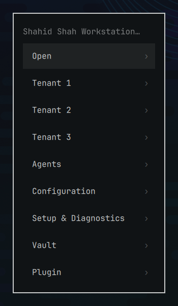
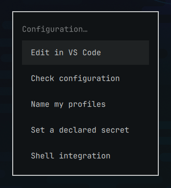

# Shahid Shah Workstation

A keyboard-first Omarchy Quattro profile for personal mail, three isolated Microsoft 365 tenants, OneDrive, ChatGPT Dot, and engineering agents. Run the same actions from the native Omarchy menu or the `snshah` CLI.



## Install

Use an Omarchy Quattro desktop with Lua-based Hyprland config. Run setup as your regular user. Package installation and system services may ask for sudo.

```bash
curl -fsSL https://raw.githubusercontent.com/shah/workstation/main/bootstrap.sh | bash
```

The bootstrap installs Bun if needed and runs the installer from a single Git revision. For a preview before applying:

```bash
mkdir -p ~/Work/github.com/shah
git clone https://github.com/shah/workstation.git ~/Work/github.com/shah/workstation
cd ~/Work/github.com/shah/workstation
command -v bun >/dev/null || { omarchy pkg add bun || omarchy pkg aur add bun-bin; }
bun --no-env-file ./snshah.ts plan
bun --no-env-file ./snshah.ts apply
```

For an existing checkout, fetch and review the update before fast-forwarding. The default root is `~/Work`. Set `workspacesRoot` in your private config for a durable change, or pass `--workspaces-root "$HOME/Client Work"` to one `plan` or `apply`. On first installation, that flag seeds the config. `snshah workspace` prints the managed checkout path.

## Open the workstation menu

- **Super + Alt + Space → Shahid Shah Workstation** opens the submenu from Omarchy’s root menu.
- **Super + Alt + M** or `snshah menu` opens it directly. Check `omarchy menu keybindings --print` if you already use the shortcut.
- `snshah plugin install` adds an optional Quickshell bar icon for the same menu. `snshah plugin toggle` opens the menu and `snshah plugin remove` removes the bar icon. The native root menu entry stays available. The plugin is bundled here and installed locally.

Use the arrow keys and Enter, or type to filter. **Open → Accounts by name** reads private display names at runtime. **Tenant 1–3** provide direct routes using stable slot numbers. The generated Omarchy menu file contains generic titles. Agent sessions, mounts, vault passphrases, and secret entry open in an Omarchy terminal. **Setup & Diagnostics → Apply changes** previews the changes and asks for confirmation.

| Menu | CLI |
| --- | --- |
| Open | `snshah open gmail\|dot\|herdr\|menu` |
| Tenant 1–3 | `snshah open work1 outlook`, `snshah drive list work2`, `snshah drive mount work3` |
| Agents | `snshah agent claude\|codex\|local [directory]` |
| Configuration | `snshah config setup\|check\|edit`, `snshah config set-secret VARIABLE`, `snshah shell` |
| Setup & Diagnostics | `snshah plan`, `snshah apply`, `snshah doctor --json`, `snshah workspace`, `snshah context`, `snshah test` |
| Vault | `snshah vault status\|backup\|verify\|restore` |
| Plugin | `snshah plugin install\|toggle\|remove` |

The native menu is generated from the command table embedded in `snshah.ts`. Omarchy’s menu definition has a fixed JSONC path. Edit the TypeScript config for workstation settings.

## Configure profiles, preferences, and secrets



The only workstation settings file is **`~/.config/snshah.conf.ts`**. Setup creates it with mode **0600**. You must own the file, and it must be a regular file. It contains executable TypeScript, so review it before loading a copy from another machine. The generated `snshah.auto.d.ts` exposes the config types to VS Code.

1. Open **Configuration → Name my profiles** or run `snshah config setup`. Enter your own names locally. The public repo and screenshots use generic titles.
2. Open **Configuration → Edit in VS Code** or run `snshah config edit`. The editor command watches for saves and checks the config. After a valid change, select **Back Up Now** in the notification or **Vault → Back up now** in the menu.
3. Run `snshah config check`, followed by `snshah plan` and `snshah apply` when a setting requires package or desktop changes.

Configuration options include:

| Setting | Values |
| --- | --- |
| `personal`, `work.work1.label`, `work.work2.label`, `work.work3.label` | Editable display names. Stable slot IDs retain browser sessions and mounts. |
| `workspacesRoot` | Absolute path for managed checkouts |
| `browser` | `{ kind: "omarchy" }` or `{ kind: "edge-default" }` |
| `prompt` | `{ kind: "starship" }` or `{ kind: "posh" }` using the bundled theme |
| `localAI` | `{ kind: "off" }` or `{ kind: "ollama", model: "qwen3-coder:30b" }` |
| `work.workN.files` | `{ kind: "web" }` or `{ kind: "rclone", remote: "example-remote" }` |

On upgrade, setup imports the old labels, model, and workspace root when it creates the TypeScript file. It uses the TypeScript file on subsequent runs.

### Shell aliases and API tokens

An interactive Bash block loads aliases and exports from `snshah shell`. Zsh users can add `eval "$(snshah shell zsh)"` to their interactive startup file. Existing aliases take precedence. The default additions include `ll` (`ls -al`), `gs`, `gd`, `gds`, `gl`, and `mkcd`.

Declare credentials in the marked `secrets` array in your private config. Example declarations with empty values:

```ts
const secrets = [
  { "variable": "EXAMPLE_API_TOKEN", "value": "", "scope": "command", "commands": ["codex"] },
  { "variable": "EXAMPLE_SHELL_TOKEN", "value": "", "scope": "shell" }
] satisfies WorkstationConfig["secrets"];
```

Use **Configuration → Set a declared secret** or `snshah config set-secret EXAMPLE_API_TOKEN` to enter a value without echoing it or putting it in a command argument. That helper edits the marked array when its entries use JSON-compatible TypeScript literals as in the example. You can also edit the code directly in VS Code.

- Use `scope: "command"` for credentials restricted to named CLI actions. The supported scopes are `claude`, `codex`, `local`, and `drive`. Start the tool through `snshah` to receive those credentials.
- Use `scope: "shell"` when every program started from the shell may inherit the credential. Load the current config in an existing shell with `eval "$(snshah shell)"`. Old shells keep their existing environment until you update or close them.

Config checks, diagnostics, the menu, and notifications omit token values. Keep the config out of Git and ordinary sync folders.

## Mail, meetings, and files

Personal Gmail and ChatGPT Dot use your Omarchy default browser. Work slots use separate Edge data directories. Open each full browser once and sign into the matching tenant:

```bash
snshah open work1 browser
snshah open work2 outlook
snshah open work3 calendar
snshah open work3 onedrive
```

Work 1 reuses the original work profile if it exists. Outlook opens the web app in its own window. In Edge, use **Apps → Install this site as an app** if you want an installed PWA. Tenant policy can affect sign-in, device compliance, and app features. [Microsoft Outlook web app guide](https://support.microsoft.com/en-us/outlook/use-the-web-version-of-outlook-like-a-desktop-app)

For a local OneDrive mount, set the tenant’s `files` to `rclone`, run `snshah apply`, then create the named remote with `rclone config`. Verify it with `snshah drive list work2` before running `snshah drive mount work2`. The mount appears at `~/OneDrive/work2`, is read-only, and stops when you press Ctrl+C in its terminal. Use the web app for edits or uploads. [rclone OneDrive setup](https://rclone.org/onedrive/)

## Dot, Herdr, and engineering agents

- `snshah open dot` opens ChatGPT Dot. Set up app connections in the intended ChatGPT workspace. [OpenAI Dot setup](https://help.openai.com/en/articles/20001530-getting-started-with-your-dot)
- `snshah open herdr` uses Herdr Desktop when installed and falls back to native Herdr in a terminal. Use separate worktrees for agents that will edit concurrently.
- `snshah agent claude /path/to/worktree` and `snshah agent codex /path/to/worktree` use your Omarchy-managed runtimes.
- To run local OpenCode, set `localAI` to `ollama` in the config and run `snshah plan` and `snshah apply`. Then run `snshah agent local`.

## Encrypted vault


The vault backs up exactly `~/.config/snshah.conf.ts`. It uses age passphrase encryption and writes a mode-0600 snapshot to `~/OneDrive/Vault-Staging`. Move the encrypted file to your **personal** OneDrive Personal Vault through OneDrive after unlocking it.

```bash
snshah vault status
snshah vault backup
snshah vault verify /path/to/snshah-config-snapshot.ts.age
snshah vault restore /path/to/snshah-config-snapshot.ts.age
```

Verify checks the snapshot format and TypeScript syntax without running the restored code. Restore writes atomically with mode 0600. To replace an existing config, use the menu to first back it up, or use `--overwrite` after making your own backup. Review the restored code before running `snshah config check`. Earlier multi-file archives are outside this single-file restore format.

## Verify changes

```bash
bun --no-env-file ./snshah.ts test
bun --no-env-file ./snshah.ts test --published
snshah plan --json
```

The self-test uses a temporary home, fake tokens, simulated system operations, and a mock age executable. For desktop acceptance, open the native submenu, launch an app, save an edit through VS Code, and exercise real age backup and verify. A second apply with identical settings should report **No changes needed**. Run `hyprctl configerrors` after changing bindings.
